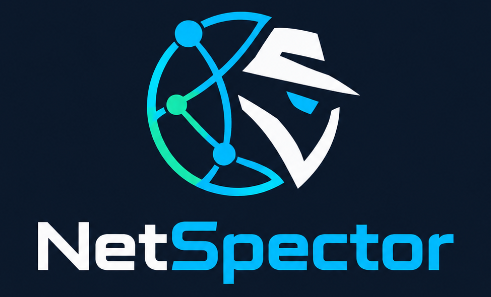

<p align="center">
  
</p>

<h1 align="center"> NetSpector - Suite de Auditoría de Seguridad Técnica</h1>

<p align="center">
  <a href="https://github.com/tokaiteio1993-1988/NetSpector/releases"></a>
  <a href="https://github.com/tokaiteio1993-1988/NetSpector/blob/main/LICENSE"></a>
  <a href="NetSpector.html"></a>
</p>
  
> **Generador y editor interactivo de informes de auditoría de seguridad conforme a la plantilla oficial de 10 secciones.**  
> Funciona tanto en **Navegador Web directo (sin necesidad de tener Python instalado)** como mediante **Script de Python**.

---

## 1. Uso en Navegador Web (Sin necesidad de Python)

Si estás en Windows y no tienes Python instalado:

1. **Abre directamente [`NetSpector.html`](NetSpector.html)** con Google Chrome, Microsoft Edge, Brave o Firefox.
2. Pulsa en **"Seleccionar Carpeta"** (o arrastra y suelta tu carpeta / archivos `.txt` en la pantalla).
3. **Mete en esa carpeta todos los `.txt` de resultados** que saques de la máquina o infraestructura (`nmap.txt`, `ss.txt`, `hostname.txt`, permisos, etc.).
4. NetSpector leerá los archivos automáticamente, cruzará los puertos y procesos, rellenará las 10 secciones del informe oficial y te mostrará el informe completo en pantalla.
5. **Modo Oscuro:** Dispone de un botón en la barra superior ("Modo Oscuro" / "Modo Claro") que guarda tu preferencia automáticamente.
6. Puedes **hacer clic en cualquier celda para editar el texto** en vivo si necesitas ajustar algo.
7. Pulsa **"Exportar a PDF"** para imprimirlo o guardarlo como documento PDF formal, o **"Guardar HTML"** para tener el informe interactivo autocontenido.
8. **Encuesta integrada:** Al final del documento dispones de una encuesta rápida de satisfacción.

---

## 2. Uso mediante Script de Python

Puedes ejecutar el script con los parámetros que necesites:

```bash
python netspector.py -d ./carpeta_auditoria -e informe_final.html -a "Nombre del Auditor" -f -n "Auditoría de Servidores" -c "AUD-2026-01"
```

### Parámetros soportados:

| Parámetro | Descripción |
|---|---|
| `-d <ruta>` | **Directorio** de trabajo donde se encuentran los archivos `.txt` de resultados. |
| `-e <salida.html>` | **Nombre o ruta completa** del archivo HTML de salida donde guardar el informe. |
| `-a <nombre>` | **Nombre del auditor** (se asigna a los campos de Auditor, Autor y Firmas). |
| `-f [fecha]` | **Fecha automática:** pone automáticamente la fecha actual (o la indicada) en todos los campos de fecha del informe. |
| `-n <nombre>` | **Nombre de la auditoría** (se coloca en el título del informe y encabezado). |
| `-c <código>` *(o `-i`, `--num`)* | **Número de informe:** si introduces un código personalizado, se usa ese; si no se indica, se genera automáticamente como `AUD-YYYY-MM-DD-0` (incrementando el secuencial `-1`, `-2`... si se generan varios el mismo día). |
| `-v, --verbose` | **Modo detallado (verbose):** muestra en consola paso a paso el análisis de archivos, sockets y puertos detectados. |
| `--version` | **Muestra la versión instalada** de NetSpector. |
| `-update, --update` | **Actualiza NetSpector** automáticamente a la última versión disponible desde GitHub. |

> **Nota:** Si ejecutas `python netspector.py` o `python generar_informe.py` sin parámetros, se abrirá un selector de carpetas gráfico para que elijas cómodamente el directorio de trabajo. Al terminar la generación, el script incluye una encuesta rápida interactiva por consola.

---

## 3. Estructura Oficial del Informe (10 Secciones)

El formato generado reproduce fielmente el modelo oficial de auditoría técnica:

1. **Datos generales del informe**: Título, código/referencia, fecha, auditor, solicitante, versión/estado y confidencialidad.
2. **Alcance y autorización**: Activo evaluado, fuera de alcance, tipo de análisis (caja blanca/negra/gris) y autorización.
3. **Identificación del equipo**: Hostname, IP / MAC, sistema operativo y versión, versión del kernel, tipo de equipo, función/criticidad, propietario y último arranque.
4. **Inventario de servicios y puertos**: Cruce inteligente de puertos abiertos, servicio, versión, proceso/usuario (`sshd/root`, etc.), accesibilidad (`Solo localhost` vs `Red local`), necesidad y observaciones.
5. **Revisión de configuración**:
   - `5.1 Cuentas y autenticación` (acceso root SSH, caducidad de contraseñas, shadow, sudoers, MFA en PAM).
   - `5.2 Red y cortafuegos` (política UFW/iptables, servicios en escucha, reenvío IPv4/IPv6).
   - `5.3 Sistema de archivos y permisos` (permisos de /etc/shadow, ficheros con escritura global, opciones de montaje).
   - `5.4 Actualizaciones y parches` (paquetes actualizables, unattended-upgrades).
   - `5.5 Registro, auditoría y copias de seguridad` (auditd, logs centralizados, NTP/timedatectl, backups).
   - `5.6 Servicios concretos` (ocultación de banner web, TLS 1.2+, cabeceras HSTS/CSP/X-Frame-Options).
6. **Vulnerabilidades detectadas**:
   - Fichas individuales por hallazgo (`VUL-01`, `VUL-02`, etc.) con CVE, componente, descripción, detección, evidencia, severidad, impacto, exploit, estado y recomendación.
   - Tabla resumen de vulnerabilidades con prioridad de corrección.
7. **Resumen ejecutivo y valoración global**: Matriz de severidades (Crítica, Alta, Media, Baja, Informativa) y resumen narrativo.
8. **Plan de remediación y recomendaciones**: Tabla priorizada con acción recomendada, mitigación temporal, responsable, fecha límite, esfuerzo y estado.
9. **Metodología y herramientas utilizadas**: Herramientas, versiones, uso, comandos ejecutados y marcas de tiempo.
10. **Anexos, evidencias y firmas**: Índice de anexos, visores colapsables con la salida íntegra de cada comando/fichero, control de versiones y bloque de firmas formales.

---

## 4. Archivos que puedes meter en tu carpeta de trabajo

Simplemente guarda en tu carpeta las salidas de los comandos que ejecutes en la máquina. NetSpector detecta automáticamente el contenido de los archivos:

| Archivo o contenido | Comando / Origen habitual | Qué se extrae automáticamente |
|---|---|---|
| `nmap*.txt` | `nmap -sV -O -p- <IP>` | Puertos, servicios, versiones, SO detectado, IP y MAC |
| `ss*.txt` / `netstat*.txt` | `ss -tulpn` o `netstat -tulpn` | Procesos, usuarios (`root`, `www-data`), puertos locales vs red |
| `hostname.txt` / `uname.txt` | `hostname`, `uname -a`, `/etc/issue` | Nombre de host, kernel y distribución Linux |
| `ficheros_escritura.txt` | `find / -xdev -type f -perm -0002` | Lista de ficheros con permisos de escritura global |
| `login_defs.txt` | `cat /etc/login.defs` | Directivas `PASS_MAX_DAYS`, `PASS_MIN_DAYS`, `PASS_WARN_AGE` |
| `general.txt` *(opcional)* | Notas del auditor | Sobrescribe datos generales, alcance o firmas |
| `hallazgos.txt` *(opcional)* | Vulnerabilidades específicas | Define o añade fichas personalizadas con campos CVE y remediación |
| `controles.txt` *(opcional)* | Listado de verificaciones | Modifica o añade verificaciones específicas para la sección 5 |
| `*.txt` / `*.log` / `*.out` | Cualquier otro resultado de auditoría | Se adjunta automáticamente al **Índice de Anexos y Evidencias** |

---

## 5. Actualizaciones

Para actualizar a la última versión en cualquier momento:

- **Desde Python:**
  ```bash
  python netspector.py -update
  ```
- **Desde Git:**
  ```bash
  git pull origin main
  ```

---

## 6. Estructura del Repositorio

```text
NetSpector/
├── Logo/                                   # Identidad visual y variantes oficiales de NetSpector
│   ├── 1_logo_principal_fondo_oscuro.png   # Logo horizontal principal (modo oscuro/banner)
│   ├── 2_logo_completo_fondo_claro.png     # Logo horizontal para fondo claro / impresión PDF
│   ├── 3_icono_fondo_oscuro.png            # Emblema circular detective/red (toolbar y avatares)
│   ├── 4_icono_app_32x32_oscuro.png        # Icono app 32x32 squircle (Favicon oscuro)
│   ├── 5_icono_app_32x32_claro.png         # Icono app 32x32 squircle (Favicon claro)
│   ├── 6_icono_16x16_a.png                 # Icono 16x16 variante A
│   ├── 7_icono_16x16_b.png                 # Icono 16x16 variante B
├── NetSpector.html                         # Aplicación web completa y editor interactivo (Cero dependencias)
├── netspector.py                           # Motor CLI de análisis y generador oficial de informes
├── generar_informe.py                      # Lanzador principal multiplataforma
├── generar_informe.bat                     # Lanzador inteligente para Windows (detecta Python o abre la App Web)
├── install.sh                              # Script de instalación para entornos Linux / Unix
├── requirements.txt                        # Requisitos (librería estándar de Python, sin dependencias externas)
├── LICENSE                                 # Licencia de código abierto MIT
└── README.md                               # Documentación oficial
```

---

## 7. Soporte, Sugerencias y Reseñas

¿Tienes alguna duda, propuesta de mejora o incidencia?
- Repositorio oficial: [https://github.com/tokaiteio1993-1988/NetSpector](https://github.com/tokaiteio1993-1988/NetSpector)
- Sección de Issues y Reseñas: [https://github.com/tokaiteio1993-1988/NetSpector/issues](https://github.com/tokaiteio1993-1988/NetSpector/issues)


